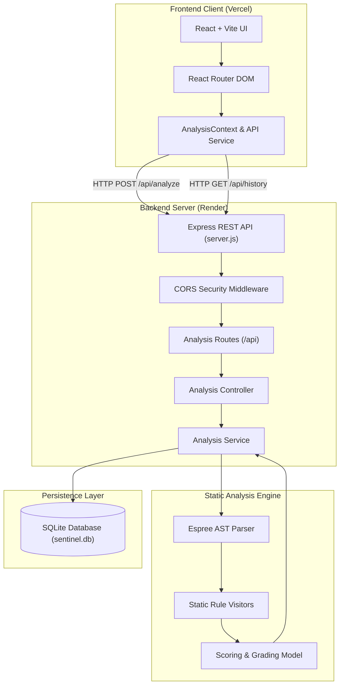

# PR Sentinel

> **Intelligent Code Review & Static Analysis Platform**  
> A full-stack developer tool designed to catch security vulnerabilities, correctness bugs, and maintainability issues before code reaches production.

[](https://pr-sentinel-six.vercel.app)
[](https://pr-sentinel-ax9n.onrender.com/api/health)
[](https://nodejs.org/)
[](https://react.dev/)
[](LICENSE)

**Live Web Application:** [https://pr-sentinel-six.vercel.app](https://pr-sentinel-six.vercel.app)  
**Production API Service:** [https://pr-sentinel-ax9n.onrender.com](https://pr-sentinel-ax9n.onrender.com)  
**Source Repository:** [https://github.com/wdymvanshika/pr-sentinel](https://github.com/wdymvanshika/pr-sentinel)

---

## Table of Contents
1. [Project Overview](#-project-overview)
2. [Problem Statement & Solution](#-problem-statement--solution)
3. [Key Features](#-key-features)
4. [Technology Stack](#-technology-stack)
5. [How the Application Works](#-how-the-application-works)
6. [System Architecture](#-system-architecture)
7. [Static Analysis Engine & Rules](#-static-analysis-engine--rules)
8. [API Endpoints & Contracts](#-api-endpoints--contracts)
9. [Local Installation & Setup](#-local-installation--setup)
10. [Environment Variable Configuration](#-environment-variable-configuration)
11. [Automated Testing](#-automated-testing)
12. [Production Deployment](#-production-deployment)
13. [Current Limitations & Future Roadmap](#-current-limitations--future-roadmap)
14. [Application Screenshots](#-application-screenshots)
15. [Author & Contact](#-author--contact)

---

## 📌 Project Overview

**PR Sentinel** is an automated code review and static analysis platform. It analyzes JavaScript source code using an Abstract Syntax Tree (AST) engine, detects vulnerabilities and logic defects, scores code quality with a transparent deduction model, and logs review history into an embedded SQLite database.

Unlike black-box scanners or probabilistic tools, PR Sentinel evaluates concrete syntactic structures deterministically using [Espree](https://github.com/eslint/espree)—the official parser behind ESLint. Every issue report provides the exact line and column numbers, severity ratings, impact explanations, and recommended remediations with suggested code fixes.

---

## ⚡ Problem Statement & Solution

### The Problem
- **Late Bug Discovery**: Security vulnerabilities (e.g. hardcoded secrets, `eval()` execution) and logic errors (e.g. loose equality, division by zero) frequently slip past manual pull request reviews into production.
- **Vague Feedback**: Generic linters often present raw error messages without explaining *why* the pattern is hazardous or *how* to safely rewrite it.
- **Opaque Scoring**: Many review tools assign arbitrary scores without clarifying how each issue impacts the overall quality assessment.

### The Solution
PR Sentinel provides an accessible, end-to-end static review pipeline:
1. **Deterministic AST Parsing**: Parses source code into standard ESTree-compliant Abstract Syntax Trees, avoiding regex-only false positives.
2. **Context-Rich Diagnostics**: Accompanies each finding with rule IDs, severity, line/column coordinates, vulnerability impact, and drop-in corrected code snippets.
3. **Transparent Quality Scoring**: Employs an explainable mathematical deduction system (Base 100 with weighted deductions per severity tier) and letter grades (`A+` through `F`).
4. **Persistent Audit History**: Automatically archives every scan record to SQLite for tracking code health over time.

---

## ✨ Key Features

- **AST-Powered Static Analysis**: Inspects ECMAScript code using deep AST traversal across both ES Modules and standard Script formats.
- **7 Explainable Detection Rules**: Covers security credentials, injection vectors, arithmetic errors, type safety, dead code, and variable hygiene.
- **Interactive Code Analyzer**: Web-based editor with syntax styling, sample presets, file upload support, and error boundary handling.
- **Granular Quality Reports**:
  - Radial score gauge with letter grading (`A+` to `F`) and quality verdicts.
  - Severity metric badges (Critical, Warning, Suggestion).
  - Categorized issue feeds with code diff suggestions.
- **Audit History & Search**: Browse past scans, filter by language or filename, and inspect previous detailed scan records.
- **Code Analytics Dashboard**: High-level metrics showing total scans, issues detected, and security risks with interactive Recharts visualizations.
- **Cross-Platform Zero-Native Database**: Embedded SQLite persistence using Node.js native `DatabaseSync` (`node:sqlite`) with fallback support for `better-sqlite3`.

---

## 🛠 Technology Stack

### Frontend
| Component | Technology | Version | Description |
|---|---|---|---|
| **Framework** | React | `^19.3.1` | Component architecture with modern hooks and state management |
| **DOM Renderer** | React DOM | `^19.3.1` | Virtual DOM rendering engine |
| **Build Tool** | Vite | `^8.3.5` | Fast build pipeline and optimized production bundler |
| **Routing** | React Router DOM | `^7.18.5` | Client-side routing with nested layout separation |
| **Icons** | Lucide React | `^1.66.0` | Clean, lightweight developer iconography |
| **Visualizations** | Recharts | `^3.10.1` | Composable charting library for dashboard score trends |
| **Styling** | Custom CSS3 | — | Dark-mode palette, CSS variables, and responsive grid layouts |

### Backend
| Component | Technology | Version | Description |
|---|---|---|---|
| **Runtime** | Node.js | `>= 22.5.0` | JavaScript server runtime supporting built-in SQLite |
| **Framework** | Express.js | `^4.21.2` | RESTful HTTP API routing and middleware framework |
| **AST Parser** | Espree | `^10.3.0` | Official ESLint AST parser for ECMAScript grammar compliance |
| **Database** | SQLite (`node:sqlite`) | Built-in | Embedded zero-config SQL persistence (with `better-sqlite3` `^11.8.1` fallback) |
| **Security & CORS** | CORS & Dotenv | `^2.8.5` / `^16.4.7` | Origin whitelist policy and environment-driven configuration |
| **Testing** | Node.js Test Runner | Native | Built-in `node:test` and `node:assert/strict` test harness |

---

## 🔄 How the Application Works

```
[ Developer Source Code ]
           │
           ▼
[ Frontend Interface ] ──► (Validates payload & prevents empty submission)
           │
      HTTP POST /api/analyze
           │
           ▼
[ Express API Gateway ] ──► (Validates payload size <= 1MB, checks language support)
           │
           ▼
[ Espree AST Parser ] ──► (Generates ESTree compliant AST with loc/range metadata)
           │
           ├─► If Syntax Error ──► Graceful diagnostic report (line/column)
           │
           ▼
[ Rule Evaluation Engine ] ──► (7 AST Visitor Rules evaluate syntax nodes)
           │
           ▼
[ Quality Scoring Calculator ] ──► (Calculates score = 100 - weighted deductions)
           │
           ▼
[ SQLite Database ] ──► (Persists scan metadata, issues JSON, and timestamp)
           │
           ▼
[ Interactive UI Report ] ──► (Renders score gauge, issue cards, and suggested fixes)
```

---

## 📐 System Architecture

The following diagram illustrates the relationship between the client application, backend server, AST engine, and persistence layer:



---

## 🔍 Static Analysis Engine & Rules

The analysis engine evaluates 7 explainable rules directly on the AST without executing user code:

| Rule ID | Severity | Category | What It Detects | Why It Matters |
|---|---|---|---|---|
| `security/detect-eval` | **Critical** | Security | Invocations of `eval()`, `window.eval()`, or `global.eval()` | Executes arbitrary strings as code, leading to Remote Code Execution (RCE) vulnerabilities. |
| `security/hardcoded-credentials` | **Critical** | Security | Hardcoded API keys, JWT secrets, AWS tokens (`AKIA...`), and GitHub PATs (`ghp_...`) | Exposing plaintext credentials in source repositories leads to immediate unauthorized access and account takeovers. |
| `correctness/division-by-zero` | **Warning** | Correctness | Explicit division where the divisor is statically `0`, `0.0`, or `-0` | Produces `Infinity` or `NaN` in JavaScript, corrupting financial calculations or data transforms. |
| `best-practice/no-loose-equality` | **Warning** | Best Practice | Comparisons using loose equality (`==` or `!=`) | Implicit type coercion triggers subtle defects (e.g. `"" == 0` evaluates to `true`). |
| `correctness/unreachable-code` | **Warning** | Correctness | Statements following `return`, `throw`, `break`, or `continue` | Dead logic indicates broken control flow or abandoned refactoring. |
| `observability/console-log` | **Suggestion** | Observability | Invocations of `console.log()` | Spams standard output in production, leaks sensitive PII, and degrades Node.js runtime throughput. |
| `quality/unused-variable` | **Suggestion** | Clean Code | Variables declared in scope but never referenced or exported | Unused variables add cognitive load and often indicate incomplete features. |
| `syntax/parse-error` | **Critical** | Grammar | Malformed JavaScript syntax (e.g. unclosed brackets, invalid tokens) | Recovers gracefully, flagging the exact syntax fault without crashing the server process. |

### Scoring & Grading Model
Scores start at **100** and decrease deterministically:
$$\text{Score} = \max\left(0, 100 - (25 \times N_{\text{critical}}) - (10 \times N_{\text{warning}}) - (2 \times N_{\text{suggestion}})\right)$$

| Score Range | Grade | Verdict |
|---|---|---|
| **95 – 100** | `A+` | Clean / Passed Quality Gate |
| **90 – 94** | `A` | Passed – Minor Suggestions |
| **80 – 89** | `B` | Passed with Warnings |
| **70 – 79** | `C` | Review Recommended |
| **60 – 69** | `D` | Significant Issues Found |
| **0 – 59** | `F` | Failed – Critical Changes Required |

---

## 📡 API Endpoints & Contracts

Base Production URL: `https://pr-sentinel-ax9n.onrender.com/api`

### 1. Health Check
- **Endpoint**: `GET /api/health`
- **Description**: Verifies API operational status, service uptime, and environment.
- **Response `200 OK`**:
```json
{
  "status": "ok",
  "uptime": 124,
  "timestamp": "2026-11-02T00:15:00.000Z",
  "service": "PR Sentinel AST Static Analysis Engine",
  "version": "1.0.0",
  "environment": "production"
}
```

---

### 2. Analyze Source Code
- **Endpoint**: `POST /api/analyze`
- **Headers**: `Content-Type: application/json`
- **Request Body**:
```json
{
  "code": "function payout(user, rate) {\n  if (rate == 0) {\n    return user.balance / 0;\n  }\n  console.log('Sending payout');\n  return eval('user.balance * rate');\n}",
  "language": "javascript",
  "filename": "payout.js"
}
```
- **Response `200 OK`**:
```json
{
  "success": true,
  "data": {
    "id": "SCAN-5812",
    "language": "javascript",
    "filename": "payout.js",
    "linesScanned": 7,
    "qualityScore": 53,
    "grade": "F",
    "verdict": "Failed – Critical Changes Required",
    "summary": {
      "critical": 1,
      "warning": 2,
      "suggestion": 1,
      "total": 4
    },
    "scoreBreakdown": {
      "base": 100,
      "criticalDeduction": 25,
      "warningDeduction": 20,
      "suggestionDeduction": 2,
      "finalScore": 53
    },
    "issues": [
      {
        "id": "ISSUE-1",
        "ruleId": "best-practice/no-loose-equality",
        "title": "Use of Loose Equality Operator ('==')",
        "severity": "warning",
        "line": 2,
        "column": 7,
        "codeSnippet": "if (rate == 0) {",
        "impact": "Implicit type coercion causes subtle comparison defects.",
        "recommendedSolution": "Replace loose equality '==' with strict equality '==='.",
        "correctedCode": "if (rate === 0) {"
      },
      {
        "id": "ISSUE-2",
        "ruleId": "correctness/division-by-zero",
        "title": "Statically Identifiable Division by Zero",
        "severity": "warning",
        "line": 3,
        "column": 12,
        "codeSnippet": "return user.balance / 0;",
        "impact": "In JavaScript, dividing by zero produces Infinity, -Infinity, or NaN.",
        "recommendedSolution": "Ensure divisors are validated before division.",
        "correctedCode": "divisor !== 0 ? numerator / divisor : 0"
      },
      {
        "id": "ISSUE-3",
        "ruleId": "observability/console-log",
        "title": "Console Log Usage in Source Code",
        "severity": "suggestion",
        "line": 5,
        "column": 3,
        "codeSnippet": "console.log('Sending payout');",
        "impact": "Console logging produces unformatted standard output in production.",
        "recommendedSolution": "Use a structured logging library (e.g. Winston, Pino)."
      },
      {
        "id": "ISSUE-4",
        "ruleId": "security/detect-eval",
        "title": "Dangerous Use of eval()",
        "severity": "critical",
        "line": 6,
        "column": 10,
        "codeSnippet": "return eval('user.balance * rate');",
        "impact": "eval() creates a critical Remote Code Execution (RCE) vulnerability.",
        "recommendedSolution": "Refactor using JSON.parse() or dedicated safe expression evaluators."
      }
    ]
  }
}
```

---

### 3. Retrieve Scan History
- **Endpoint**: `GET /api/history?limit=10&offset=0`
- **Description**: Returns paginated audit summaries ordered newest first.
- **Response `200 OK`**:
```json
{
  "success": true,
  "count": 1,
  "data": [
    {
      "id": "SCAN-5812",
      "language": "javascript",
      "filename": "payout.js",
      "qualityScore": 53,
      "grade": "F",
      "verdict": "Failed – Critical Changes Required",
      "summary": { "critical": 1, "warning": 2, "suggestion": 1, "total": 4 },
      "createdAt": "2026-11-02T00:15:30.000Z"
    }
  ]
}
```

---

### 4. Retrieve Scan by ID
- **Endpoint**: `GET /api/history/:id`
- **Description**: Returns full diagnostic details and submitted source code for a specific scan.

---

## 💻 Local Installation & Setup

### Prerequisites
- **Node.js**: `v22.5.0` or higher (recommended for built-in `node:sqlite`).
- **npm**: `v9.0.0` or higher.
- **Git** installed on your system.

### 1. Clone the Repository
```bash
git clone https://github.com/wdymvanshika/pr-sentinel.git
cd pr-sentinel
```

---

### 2. Backend Setup

#### Windows (PowerShell)
```powershell
cd backend
npm install
Copy-Item .env.example .env
npm run dev
```

#### macOS / Linux (Bash)
```bash
cd backend
npm install
cp .env.example .env
npm run dev
```

The backend server boots on `http://localhost:5000`.

---

### 3. Frontend Setup

Open a second terminal window:

#### Windows (PowerShell)
```powershell
cd frontend
npm install
Copy-Item .env.example .env
npm run dev
```

#### macOS / Linux (Bash)
```bash
cd frontend
npm install
cp .env.example .env
npm run dev
```

The frontend application starts on `http://localhost:5173` (or `5174`). Open your browser and navigate to the displayed URL.

---

## ⚙ Environment Variable Configuration

Both the frontend and backend utilize environment templates (`.env.example`).

### Backend (`backend/.env.example`)
```env
# Server Configuration
# On Render, PORT is assigned dynamically by the host environment.
# Defaults to 5000 locally.
PORT=5000
NODE_ENV=development # Set to 'production' on Render

# Production Frontend URL for CORS Whitelist
# Example: https://pr-sentinel-six.vercel.app
FRONTEND_URL=

# Additional CORS Origins (comma-separated, optional)
# Localhost development ports (5173, 5174) are always allowed by default.
CORS_ORIGIN=http://localhost:5173,http://localhost:5174

# SQLite Database Storage Location
# Default: ./data/sentinel.db inside backend directory
# Note: On Render's ephemeral disk, mount a Persistent Disk and set DB_PATH=/var/data/sentinel.db
DB_PATH=./data/sentinel.db
```

### Frontend (`frontend/.env.example`)
```env
# Backend REST API Base URL
# Local development:
VITE_API_BASE_URL=http://localhost:5000/api

# Production example:
# VITE_API_BASE_URL=https://pr-sentinel-ax9n.onrender.com/api
```

---

## 🧪 Automated Testing

PR Sentinel features a complete automated test suite powered by the native Node.js test runner (`node:test`). Tests cover AST inspection rules, edge cases, input validation, HTTP route responses, and database operations.

To run the backend test suite:
```bash
cd backend
npm test
```

### Test Suite Execution Output
```text
▶ Static Analysis Engine - Ruleset Verification
  ✔ Rule 1: Division by zero is detected
  ✔ Rule 2: Hardcoded secrets and credentials are detected
  ✔ Rule 2b: Cloud token formats (AWS key) are flagged with high confidence
  ✔ Rule 3: console.log is flagged as a suggestion, NOT a critical issue
  ✔ Rule 4: eval() usage is flagged as a critical vulnerability
  ✔ Rule 5: Loose equality (==) is detected with strict suggestion
  ✔ Rule 6: Unreachable code following return statement is detected
  ✔ Rule 7: Unused variables are flagged as suggestions
  ✔ Clean code produces 100 quality score and no issues
  ✔ Syntax errors are handled gracefully without throwing unhandled exceptions
✔ Static Analysis Engine - Ruleset Verification (10 tests)

▶ Analysis Service & Validation
  ✔ Rejects empty or whitespace-only code with 400 status
  ✔ Rejects missing code parameter with 400 status
  ✔ Rejects unsupported language with informative message
  ✔ Successfully analyzes and persists to database
✔ Analysis Service & Validation (4 tests)

▶ PR Sentinel Express HTTP API Endpoints
  ✔ GET /api/health returns status 200 and health metadata
  ✔ POST /api/analyze successfully analyzes source code and returns structured JSON
  ✔ POST /api/analyze validates missing code parameter
  ✔ POST /api/analyze validates unsupported language
  ✔ GET /api/history returns list of previous analyses
  ✔ GET /api/history/:id returns specific analysis by ID
  ✔ GET /api/history/:id returns 404 for non-existent scan ID
  ✔ GET /api/nonexistent-route returns 404 not found JSON response
  ✔ CORS allows requests from permitted origin
  ✔ CORS rejects requests from untrusted external origin
✔ PR Sentinel Express HTTP API Endpoints (10 tests)

ℹ tests 24
ℹ suites 3
ℹ pass 24
ℹ fail 0
```

---

## 🚀 Production Deployment

### Frontend (Vercel)
- **Hosted At**: [https://pr-sentinel-six.vercel.app](https://pr-sentinel-six.vercel.app)
- **Framework Preset**: Vite
- **Build Command**: `npm run build`
- **Output Directory**: `dist`
- **Environment Variable**:
  - `VITE_API_BASE_URL`: `https://pr-sentinel-ax9n.onrender.com/api`

### Backend (Render)
- **Hosted At**: [https://pr-sentinel-ax9n.onrender.com](https://pr-sentinel-ax9n.onrender.com)
- **Service Type**: Web Service
- **Root Directory**: `backend`
- **Runtime**: Node (`engines`: `>=22.5.0`)
- **Build Command**: `npm install`
- **Start Command**: `npm start`
- **Environment Variables**:
  - `NODE_ENV`: `production`
  - `FRONTEND_URL`: `https://pr-sentinel-six.vercel.app`
  - `PORT`: Handled automatically by Render (binds to `0.0.0.0`)
  - `DB_PATH`: `./data/sentinel.db` (or `/var/data/sentinel.db` when attached to a Render Persistent Disk)

---

## ⚠️ Current Limitations & Future Roadmap

To ensure technical transparency, the current scope and known limitations of the project are documented below:

### Current Limitations
- **Language Scope**: The AST analysis engine currently supports JavaScript (ES Modules and CommonJS/Script). TypeScript and other languages are not yet analyzed.
- **File Scope**: Analysis is currently performed on single source files or submitted snippets; multi-file repository dependency graphing is not yet implemented.
- **Ephemeral Storage on Free Tier**: Render's free instance tier uses an ephemeral filesystem. SQLite records reset when the container spins down unless a Render Persistent Disk is attached.

### Future Roadmap
- [ ] **TypeScript AST Support**: Integrate `@typescript-eslint/parser` for type-aware static checking.
- [ ] **Custom Rule Engine**: Allow engineering teams to define custom AST rules via JSON configuration.
- [ ] **Exportable Reports**: Generate downloadable PDF and SARIF (Static Analysis Results Interchange Format) audit reports for CI/CD ingestion.
- [ ] **PostgreSQL Migration Option**: Add a dual database adapter for managed relational databases in high-concurrency environments.

---

## 📸 Application Screenshots

> *Screenshots from the production build:*

### 1. Landing Page & Hero
<!-- Replace with: docs/screenshots/landing-page.png -->
```
[ PLACEHOLDER: Landing Page Hero & Feature Overview ]
```

### 2. Code Analyzer & Editor
<!-- Replace with: docs/screenshots/code-analyzer.png -->
```
[ PLACEHOLDER: Code Analyzer with Code Snippet & Language Selector ]
```

### 3. Detailed Analysis Results & Remediation Cards
<!-- Replace with: docs/screenshots/analysis-results.png -->
```
[ PLACEHOLDER: Quality Score Gauge, Verdict Badge, and Code Fix Suggestions ]
```

### 4. Review History & Analytics Dashboard
<!-- Replace with: docs/screenshots/dashboard.png -->
```
[ PLACEHOLDER: Quality Trends Chart and Historical Scans Audit Table ]
```

---

## 👤 Author & Contact

**PR Sentinel** was developed as an open-source static analysis and code review platform.

- **GitHub Repository**: [@wdymvanshika/pr-sentinel](https://github.com/wdymvanshika/pr-sentinel)
- **Live Frontend**: [https://pr-sentinel-six.vercel.app](https://pr-sentinel-six.vercel.app)
- **Live API Endpoint**: [https://pr-sentinel-ax9n.onrender.com/api/health](https://pr-sentinel-ax9n.onrender.com/api/health)
- **License**: MIT License
